### 🤝 [Benevolence](https://github.com/bswaby/Touchpoint/tree/main/TPxi/Benevolence)
**Every request for help, from the form to the pickup.**

Benevolence runs inside TouchPoint on your own request form, committee and people. Routers give requests out, committee members call and decide, and everyone works from the same page while what people share stays private.

- ⚙️ **Implementation Level:** Moderate (a role, a form setting and a checklist in Settings)
- 🧩 **Installation:** Single script. Paste into Special Content > Python as `TPxi_Benevolence`, open `/PyScriptForm/TPxi_Benevolence`, and Settings walks you through the rest.

  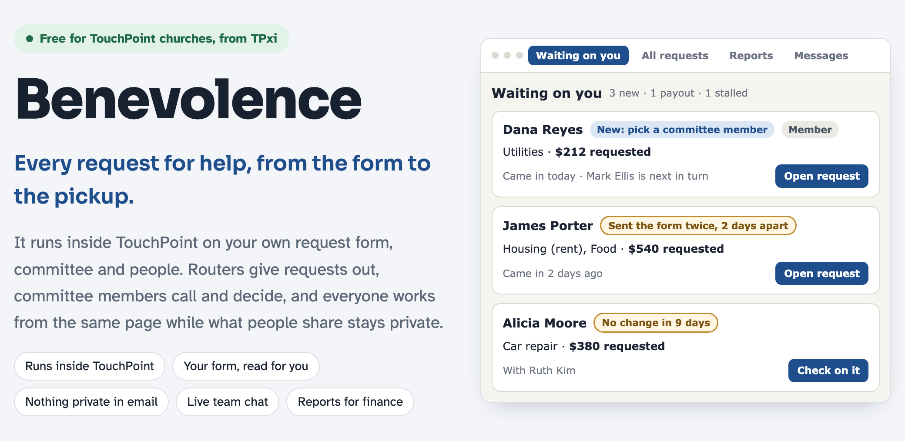

  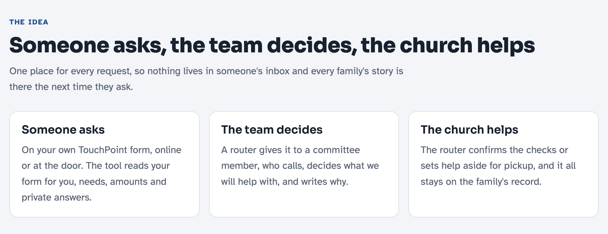

## One request, start to finish
The pictures below are the real screens with made-up people.

<strong>1. Someone asks for help</strong>

They fill out your own request form. The tool reads it for you: needs, amounts, who is in the home, and private answers, following the form's skip logic.

  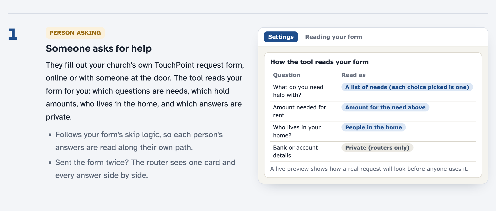

<strong>2. The router looks first</strong>

The family, membership and every earlier request are on one page. The router gives it to a committee member in turn, or declines it right away if your church allows.

  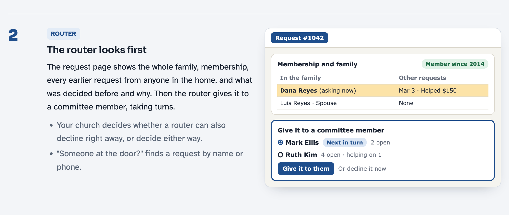

<strong>3. A committee member reaches out</strong>

Call notes beside what they wrote, your church's call questions, every try logged, and secure messages or the documents link by text or email.

  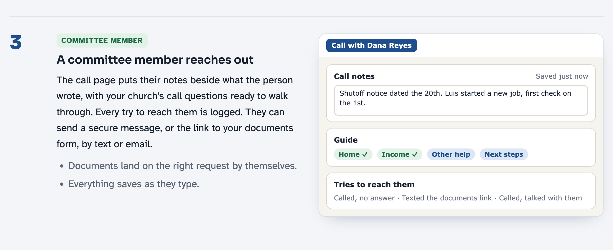

<strong>4. They decide, and write why</strong>

What we will help with, how much and how, or a decline with a reason and a referral. A checklist shows what your church requires before it can be sent.

  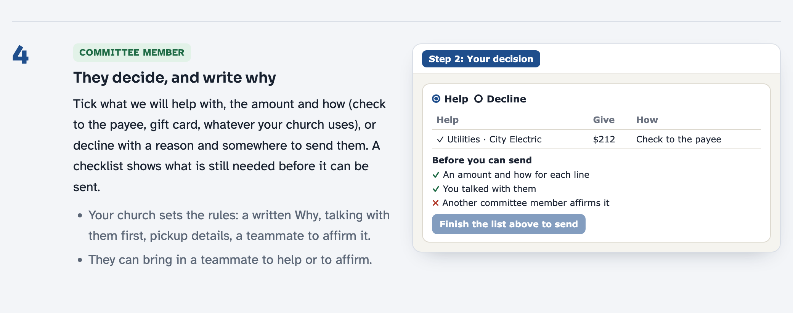

<strong>5. The team talks it through</strong>

A live team chat on every request that never reaches the person asking. It shows who is there right now, and email waits until someone is away.

  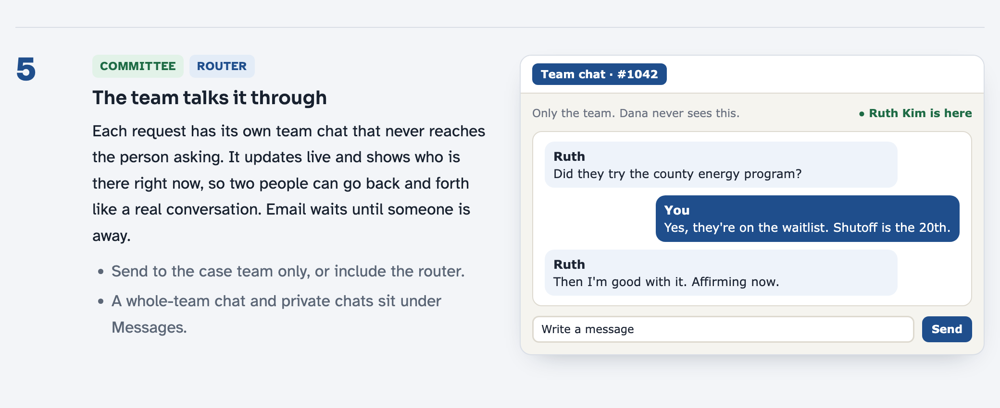

<strong>6. The router confirms the payouts</strong>

Each line is ticked as the check is written or the card is set aside, then mailed or held for pickup at a set place, day and time.

  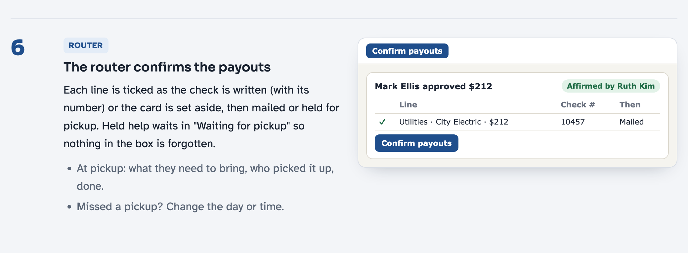

<strong>7. It stays on the record</strong>

The next time the family asks, whoever works the case sees what was decided before, the Why and the call notes.

  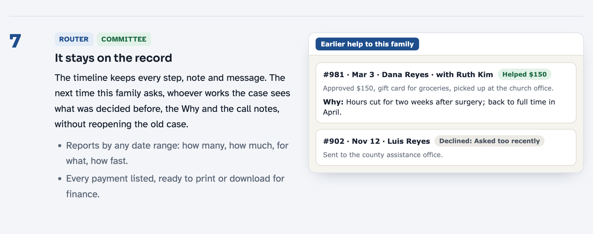

## Who does what, and who sees what

  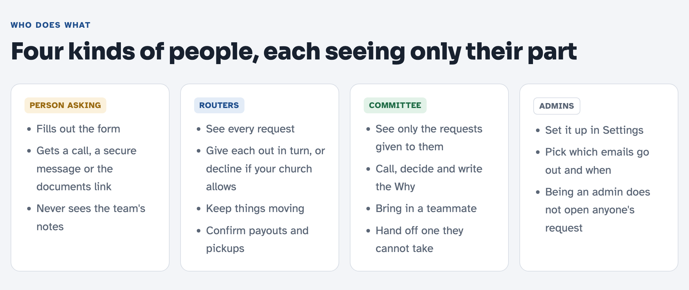

  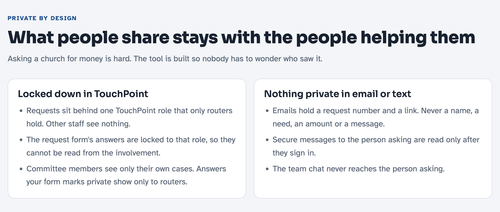

## Keeping it moving

  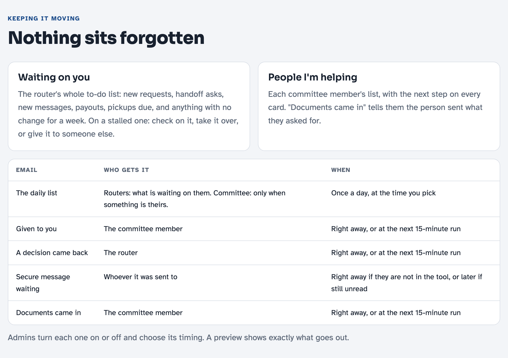

## Getting started

  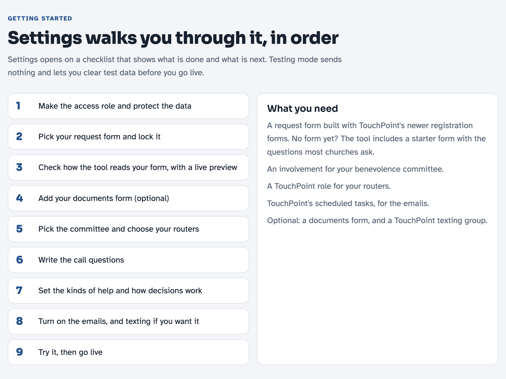

1. Paste the script into **Special Content > Python** as `TPxi_Benevolence`.
2. Open **`/PyScriptForm/TPxi_Benevolence`** (not `/PyScript/`). Settings opens on **Getting started**, a checklist that says what is done and what is next.
3. Create a TouchPoint role named **Benevolence** (or pick one you already use) and give it to your **routers only**. Committee members do not need it.
4. On your request form's involvement, set **Limit To Role** to that role. Going live waits until this is done.
5. Pick your committee involvement and your routers, write your call questions, and set your kinds of help.
6. Try it in **Testing** mode (nothing is emailed), then press **Go live**. Turning on emails adds its own line to TouchPoint's scheduled tasks.

**What you need:** a request form built with TouchPoint's newer registration forms (no form yet? the tool includes a starter form), an involvement for your committee, and a role for your routers.

**Help inside the tool:** How it works has a guide for each role. Routers see the overview, the router guide and the committee guide; committee members see only theirs; admins also see the admin guide.

<strong>Privacy notes for admins</strong>

- The tool checks who can get in on every page and every action. A `#Roles` line does not keep anyone out of `/PyScriptForm`, so the access role and the committee involvement are the real gates.
- Being a TouchPoint admin opens Settings only, not anyone's request. List yourself as a router for that.
- Request details are kept in a protected extra value on the person who asked, never in Special Content.
- Anyone with SQL report rights in TouchPoint can still read form answers and extra values, so keep that right to people you would trust with this.
