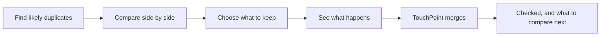
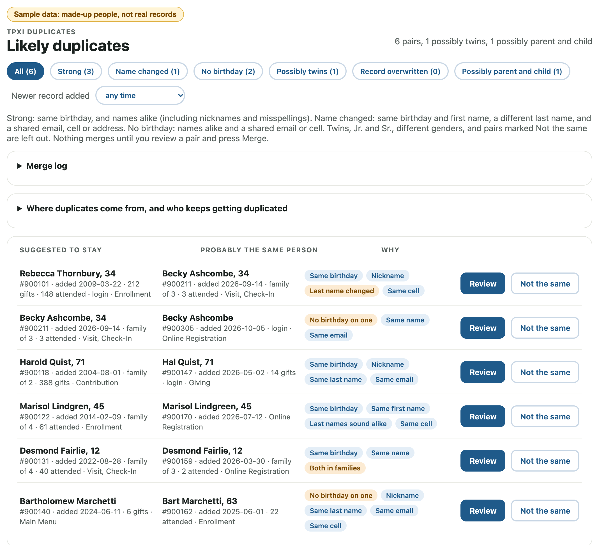
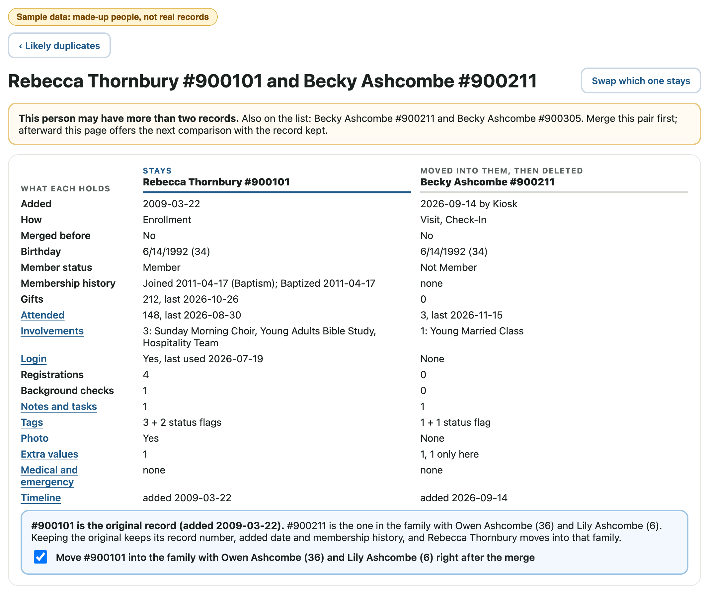
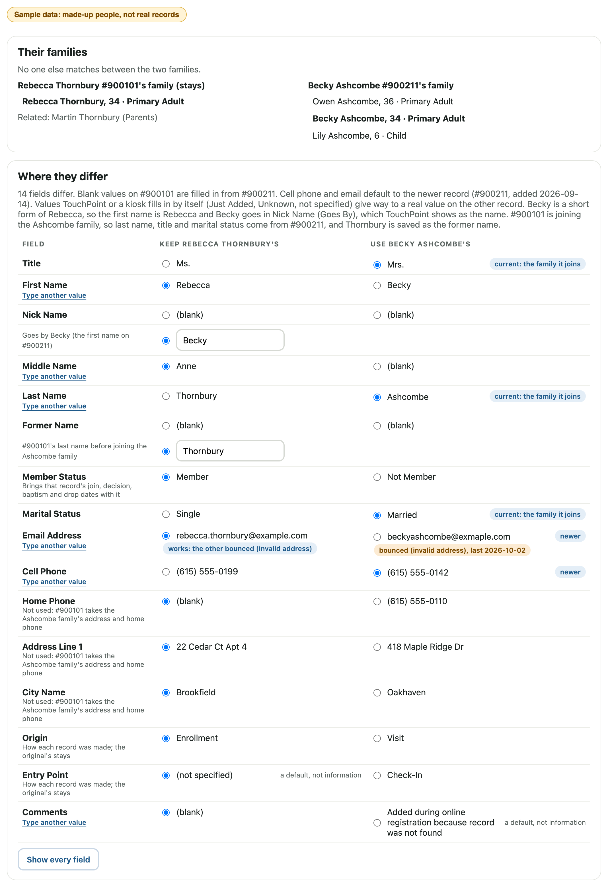
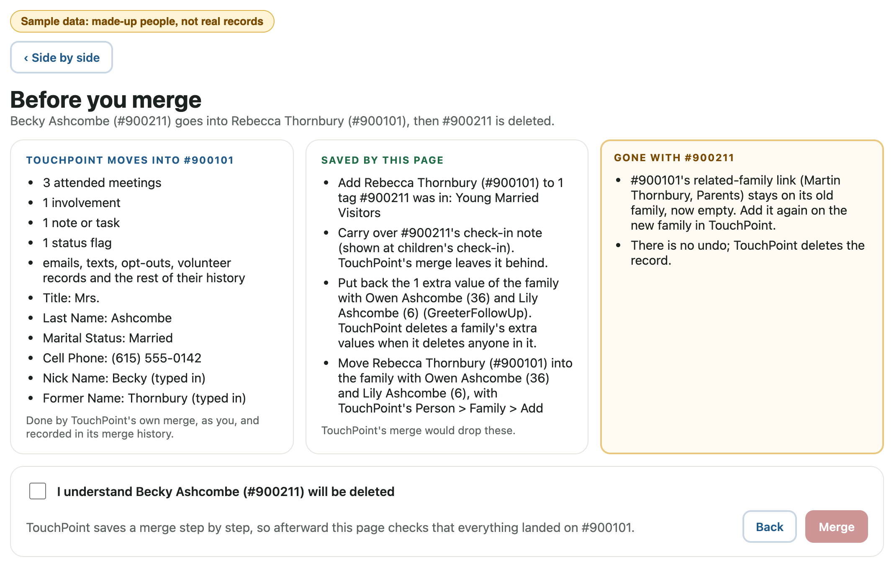
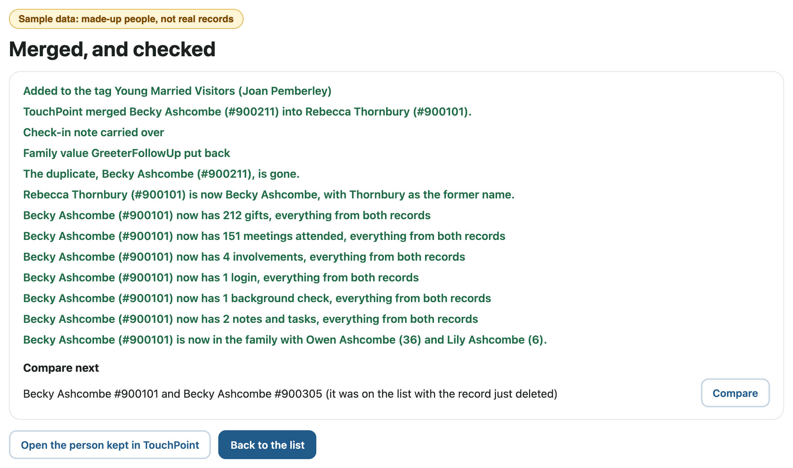

# TPxi Duplicates

A friendlier way to find and merge people who are in TouchPoint twice. TouchPoint still does the merge; this page finds the pairs, compares them, catches what TouchPoint's merge would leave behind, and checks the result.

Try it on a test pair before a real one. The screenshots below are sample data: made-up people, not real records.



## 1. Find likely duplicates



It looks across the whole church, not one person at a time:

- **The same person entered twice:** same birthday and matching names, even with a nickname (Bill and William) or a misspelling (Katelyn and Caitlin).
- **A last name changed by marriage:** same birthday and first name, a different last name, and a shared email, cell or address.
- **No birthday on file:** matching names plus a shared email or cell.

Each pair says why it matched. Jr. and Sr., different genders, and pairs marked **Not the same** are left out. Likely twins, a parent and child with the same name, and a record a form wrote someone else over get their own groups, so they are not merged by mistake.

**Where duplicates come from** shows how each newer record was added and who keeps getting duplicated, so the cause can be fixed.

## 2. Compare side by side



- **What each record holds,** from giving and attendance to notes, tags, photo, medical info and a timeline. Click a row to see what is in it for both.
- **The original record stays,** with its record number and membership history. If the newer record is the one in the family, the original moves into that family, bringing its own children if you choose.
- **More than two records?** The page says so, and after the merge it offers the next comparison.
- **Both families are shown**, with a Compare button for anyone who looks like they are in both.

## 3. Choose what to keep



Only the fields that differ are shown, already picked sensibly:

- the newer cell and email, but never an address that has been bouncing
- the spelling the family uses, or the usual spelling when the other is a typo
- a nickname saved as **Goes By** (Rebecca, goes by Becky)
- a married name, with the old last name saved as **Former Name**

You can change any pick or type a value neither record has.

## 4. See what happens before you merge



What TouchPoint moves, what this page saves that the merge would drop, and what is gone for good. There is no undo.

## 5. Merged, and checked



The merge runs as you, so it is in TouchPoint's merge history under your name. The page checks that everything landed and offers what to compare next.

## What changes in TouchPoint

- When you press **Merge**, TouchPoint merges the two people and **deletes** the duplicate, exactly as its own merge screen does.
- The person kept is added to the duplicate's tags. Tags the duplicate owned are rebuilt under the person kept.
- TouchPoint deletes a family's extra values when it deletes anyone in that family. This page puts them back.
- When both records have the same extra value, you choose which stays, so no copy ending in _mv is left behind.
- The **check-in note** and the **MinistrySafe account link** are not on TouchPoint's merge screen, so this page carries them over.
- When both records have medical info, TouchPoint keeps the duplicate's. You are warned first.
- **A merge log** is kept on the person: when, who, what the deleted record held, the choices made, and anything to check (see **Merge log** on the list). **Not the same** records who and when. Both are seen only by **Admin** and **Manager2**, set up the first time an Admin opens the page. The log never includes giving.

Nothing changes until you press Merge. No emails or texts are sent.

## Install

1. Go to **Admin > Advanced > Special Content > Python** and add a script named **TPxi_Duplicates**.
2. Paste in `TPxi_Duplicates.py` and save.
3. Open **/PyScriptForm/TPxi_Duplicates**.
4. Optional: add it to a menu in CustomReports:
   ```xml
   <Report name="TPxi_Duplicates" type="PyScript" role="Admin" />
   ```

Only the **Admin** and **Manager2** roles can use it. These are the roles TouchPoint lets delete a duplicate during a merge. People without the **Finance** role see giving as hidden; the merge still moves every gift.

## Updates

When a newer version is out, an Admin sees a banner with **Update now**. It saves the new version over the script, and saved marks stay as they are.

## Good to know

- **Compare any two people** at the bottom of the list picks any two by name or record number.
