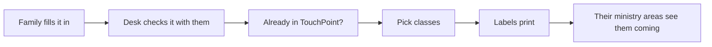
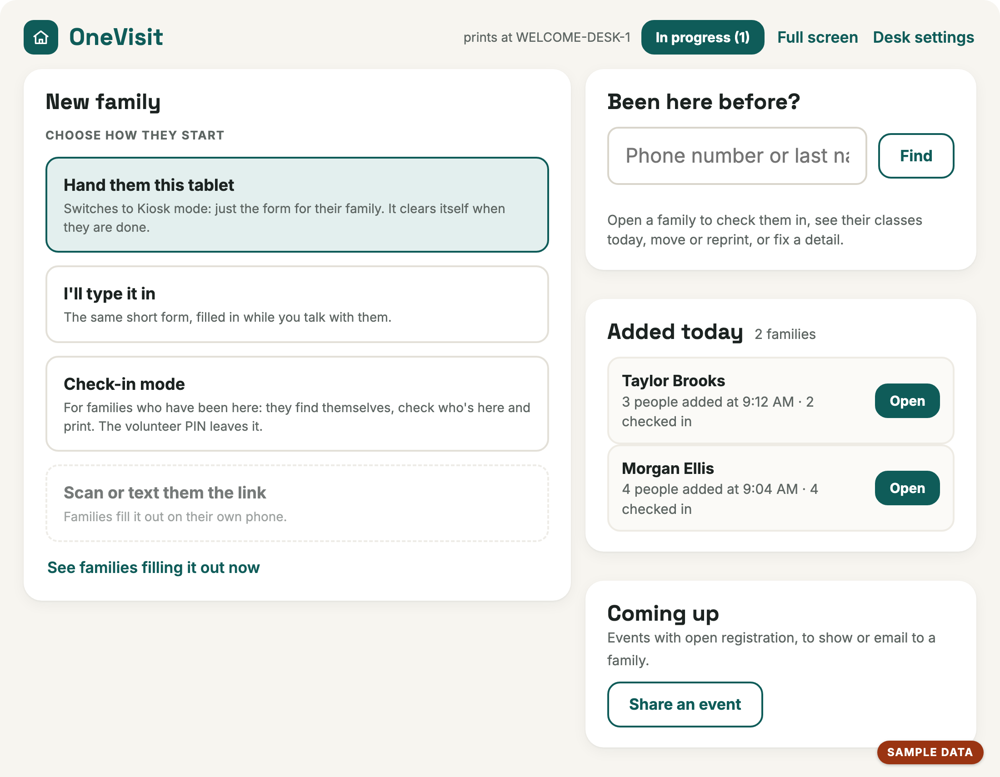

# OneVisit

**One visit is all it takes.** A welcome desk for new families: they tell you once, each child is placed in a class by your own check-in rules, and labels print at the desk. Every ministry knows them after that.

The screenshots are sample data: made-up people, not real records.

## The desk

A family can start four ways:

- **Hand them this tablet.** Kiosk mode shows only the form for their family, clears itself when they finish or walk away, and needs a volunteer PIN to leave.
- **I'll type it in.** The same short form, filled in while you talk with them.
- **Scan or text them the link.** They fill it in on their own phone (the phone sign-up add-on, below).
- **Check-in mode.** For families who have been here: they find themselves by phone, name, QR code or card, check who's here, and print.

Sign-ups wait under **In progress** until a volunteer opens them. **Been here before?** finds a family to check in, reprint or fix a detail.

## Already in TouchPoint?

Before anyone is added, OneVisit looks for every person on the sign-up, children first. People already in TouchPoint keep their record; new people join their family. A maybe becomes one question to ask the family. Names, birthdays and gender on an existing record are never changed.

The full walk-through, with every question a volunteer might see: **[Already in TouchPoint?](Already-in-TouchPoint.md)**

## Classes and labels

Classes come from your check-in rules (birthday range or grade). Labels print through TouchPoint's check-in with your label designs, test-built first so one broken design cannot jam a printer. **Church setup** can send each ministry area's labels to that area's printer.

## Receiving screens

Open OneVisit with **#receive** on a ministry area's screen: who is on the way, first-time guests, allergies, pickup notes, and who is here by class.

## Phone sign-up (add-on)

Families fill in the form on their phone from a QR code at the door or a texted link, and it lands under **In progress**. It is a paid confsched add-on, with a 30-day free trial in **Church setup > Phone sign-up**. Sign-ups wait at confsched only until your TouchPoint collects them.

## Workflows: sign-ups with their own steps

A gym membership or volunteer onboarding: a desk works the steps, and OneVisit does the rest. Build one in **Church setup > Workflows and desks**, starting from a template.

- **Starts when** says what brings someone in: the forms that start it, and the desks that offer them (typed at the desk, on a tablet, or on their own phone).
- **Each step reads as plain sentences:** automatic, a decision at a desk, a check that decides by itself, or waiting on the family (a form, a payment).
- **The process** draws every path, and **Try it with a test person** shows what each step would do, writing nothing.
- **If nobody decides,** a step can email the team and move the sign-up on.

More, with every building block: **[OneVisit workflows](Workflow-Functions.md)**

## What changes in TouchPoint

- **People, families, attendance, labels, class enrollments, authorized pickups, allergies and emergency contacts** are saved through TouchPoint's own check-in, the way its kiosk and admin check-in save them.
- **Someone already in TouchPoint:** only what the volunteer keeps on the plan (a blank cell, email, allergy or emergency contact filled in, or a ticked change). A cell or email your church locked with No edit stays as it is unless an Admin is signed in.
- **"OK to text"** is set on adults the desk just added, when the family says yes.
- **Special Content files starting TPxiOneVisit_:** families in progress (cleared once saved, never kept past 30 days), the phone sign-up key, and the installed copy. Church setup is the setting TPxiOneVisitConfig, with no personal information.
- **Extra values:** a linked card as a scrambled key, never the card number, and what Coming up showed each family.
- **Workflows** change involvements, member types, tags, extra values and tasks only as their steps say, keep each sign-up's progress on the person who signed up (an extra value starting TPxiOVFlow_), and save desk photos to the person's record.

## What sends a text or email

Only these:

- **Text it** sends the sign-up link to the number typed, from the texting group Church setup picks (your own PoweredByText or Twilio account). The same number gets at most one text every 2 minutes.
- **Coming up** can text or email one event to one person, and **Send me these** emails one summary to the person who asked.
- **Workflows** send the texts and emails their steps say (a thank-you, a form link, a reminder, a welcome), written by an admin in Church setup. They can also email the team (an involvement, its leaders, a saved search or people picked, at most 25), for example when a sign-up has waited too long at the desk.

## Install

1. Go to **Admin > Advanced > Special Content > Python** and add a script named **TPxi_OneVisit**.
2. Paste in `TPxi_OneVisit_Starter.py` and save. The starter fetches the current signed release and keeps it updated.
3. Open **/PyScriptForm/TPxi_OneVisit**. People with the **Admin**, **Checkin** or **OneVisit** role can use it.
4. On each desk tablet, open **Desk settings**: name the print station, choose the check-in profile, set the volunteer PIN, and link the desk to a TouchPoint login once. Use one dedicated desk account per desk or area. The password is used once and never stored; to cut a desk off, lock its account.
5. An admin opens **Church setup** for ministry areas, label setups, printing plans and what new desks start with.

## Updates

**Church setup > Updates** picks Stable or Beta and when updates install (by default never Saturday 6 PM to Sunday 1 PM), and can go back to any of the last three versions. A desk is never refreshed in the middle of a family.

## Good to know

- **Try it on a test family first,** with made-up names and 555 phone numbers.
- **Pasting `TPxi_OneVisit.py` directly** works too, without automatic updates.
