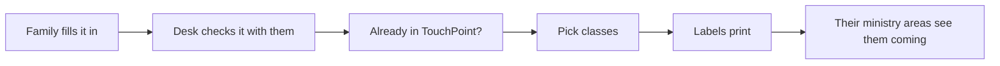
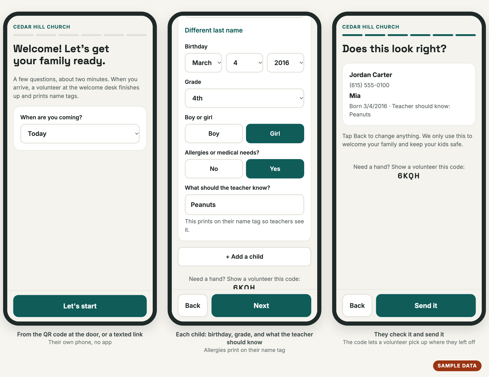
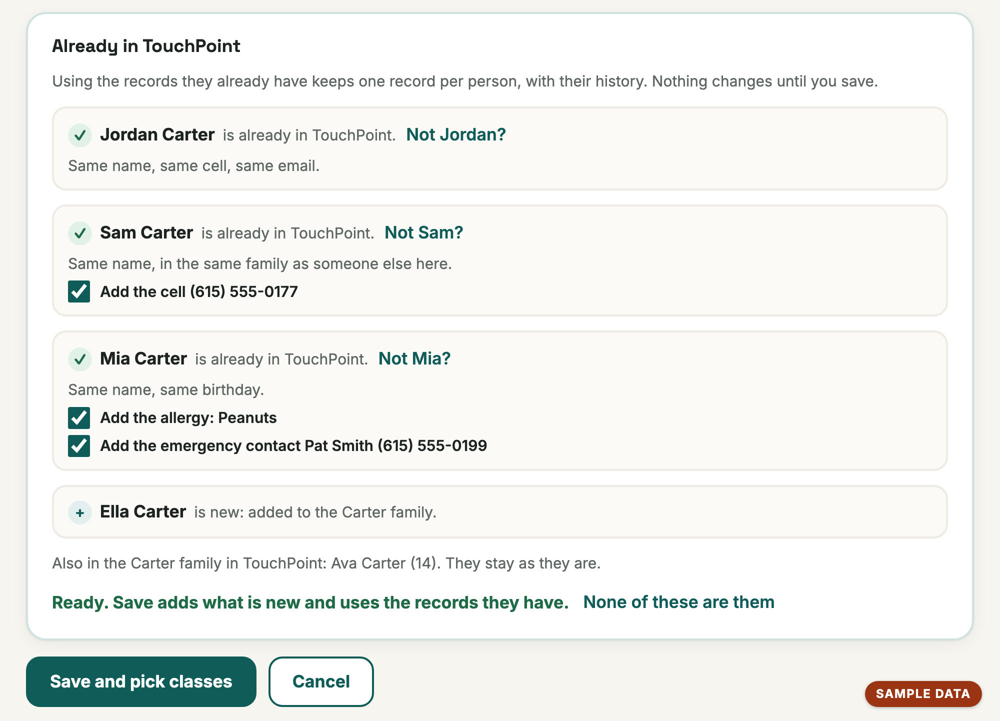
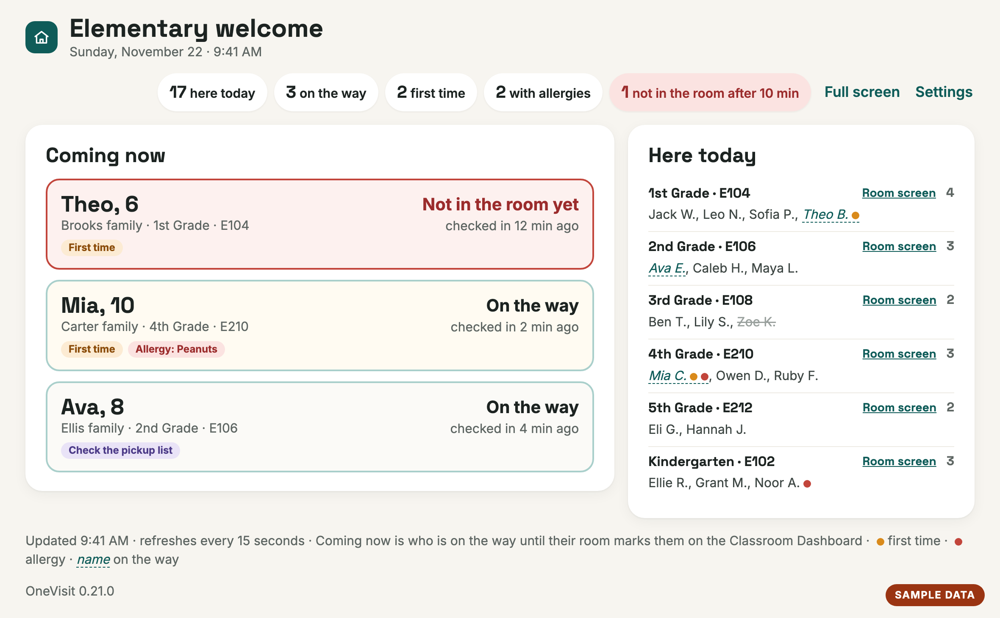
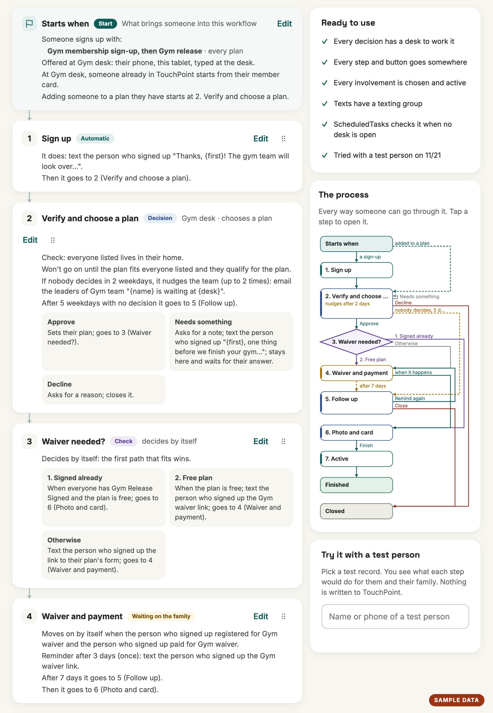
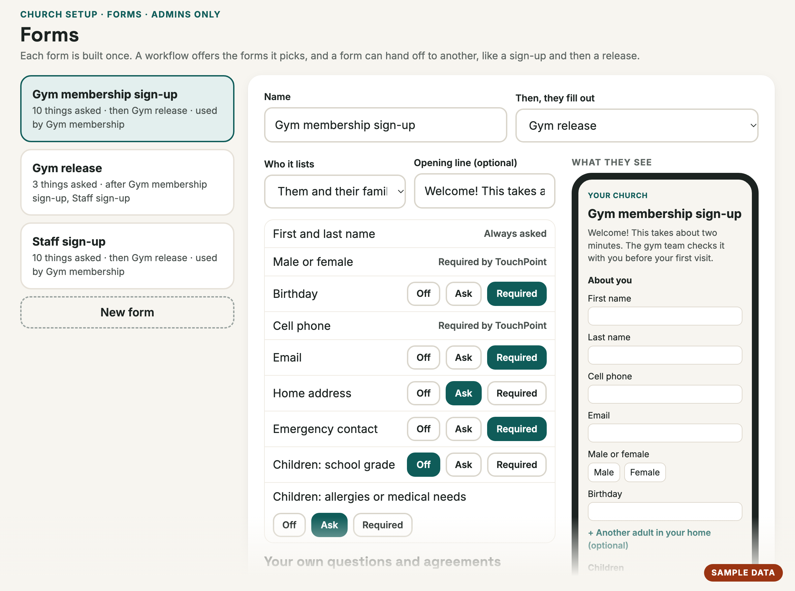

# OneVisit

**One visit is all it takes.** A welcome desk for new families: they tell you once, each child is placed in a class by your own check-in rules, and labels print at the desk. Every ministry knows them after that.

The screenshots are sample data: made-up people, not real records.

## The desk

A family can start four ways:

- **Hand them this tablet:** kiosk mode, just their family's form. It clears itself, and leaving takes a volunteer PIN.
- **I'll type it in** while you talk with them.
- **Scan or text them the link** for their own phone (below).
- **Check-in mode** for families who have been here: they find themselves, check who's here, and print.

Sign-ups wait under **In progress** until a volunteer opens them.

## Phone sign-up (add-on)

From a QR code at the door or a texted link, families fill it in on their own phone and it lands under **In progress**. A paid confsched add-on, with a 30-day free trial in **Church setup > Phone sign-up**. Sign-ups wait at confsched only until your TouchPoint collects them.

## Already in TouchPoint?

Before anyone is added, OneVisit looks for every person on the sign-up. People already in TouchPoint keep their record, new people join their family, and a maybe becomes one question for the family. Names, birthdays and gender on a record are never changed. The walk-through: **[Already in TouchPoint?](Already-in-TouchPoint.md)**

## Classes and labels

Classes come from your check-in rules (birthday range or grade). Labels print through TouchPoint's check-in with your designs, test-built first so a broken design cannot jam a printer.

## Receiving screens

Open OneVisit with **#receive** on a ministry area's screen: who is on the way, first-time guests, allergies, pickup notes, and who is here by class. A child not yet marked in by their room (TouchPoint's Classroom Dashboard) is flagged.

## Workflows: sign-ups with their own steps

A gym membership or volunteer onboarding: a desk works the steps, and OneVisit does the rest. Build one in **Church setup > Workflows and desks** from a template.

Each step reads as plain sentences: automatic, a decision at a desk, a check that decides by itself, or waiting on the family (a form, a payment). **The process** draws every path, and **Try it with a test person** writes nothing. More: **[OneVisit workflows](Workflow-Functions.md)**

## Forms

Built once, beside a preview of their phone: who it lists, which details to ask, up to 8 questions of your own, and agreements they sign by typing their name. More: **[OneVisit forms](Forms.md)**

## What changes in TouchPoint

- **People, families, attendance, labels, classes, pickups, allergies and emergency contacts** go through TouchPoint's own check-in, the way its kiosk saves them.
- **Someone already in TouchPoint:** only what the volunteer keeps on the plan, and No edit locks hold unless an Admin is signed in.
- **"OK to text"** on adults just added, when the family says yes.
- **Special Content files starting TPxiOneVisit_** (families in progress, gone once saved or after 30 days; the phone key; the installed copy) and the setting **TPxiOneVisitConfig** (no personal information).
- **Extra values:** a card as a scrambled key (never the number), form answers, signed agreements, what Coming up showed, and workflow progress (TPxiOVFlow_).
- **Workflows** change involvements, member types, tags and tasks only as their steps say, and save desk photos and signed copies to the record.

## What sends a text or email

Only these:

- **Text it** sends the sign-up link to the number typed, through your own PoweredByText or Twilio account, at most once every 2 minutes per number.
- **Coming up** texts or emails one event to one person; **Send me these** emails one summary to whoever asked.
- **Workflows** send what an admin wrote into their steps: a thank-you, a form link, a reminder, or a note to the team (at most 25 people).

## Install

1. Go to **Admin > Advanced > Special Content > Python** and add a script named **TPxi_OneVisit**.
2. Paste in `TPxi_OneVisit_Starter.py` and save. The starter fetches the current signed release and keeps it updated.
3. Open **/PyScriptForm/TPxi_OneVisit**. People with the **Admin**, **Checkin** or **OneVisit** role can use it.
4. On each desk tablet, open **Desk settings**: print station, check-in profile, volunteer PIN, and a one-time link to a dedicated TouchPoint desk account. The password is never stored; to cut a desk off, lock its account.
5. An admin opens **Church setup** for ministry areas, label setups, printing and what new desks start with.

## Updates

**Church setup > Updates** picks Stable or Beta, when updates install (never Saturday 6 PM to Sunday 1 PM by default), and can go back three versions. A desk never refreshes in the middle of a family.

## Good to know

- **Try it on a test family first,** with made-up names and 555 phone numbers.
- **Pasting `TPxi_OneVisit.py` directly** works too, without automatic updates.
