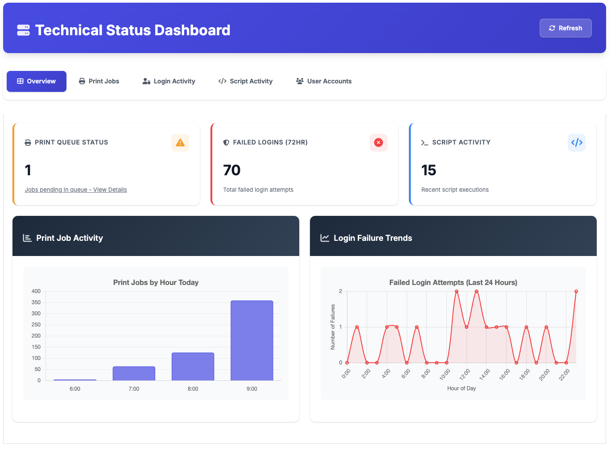
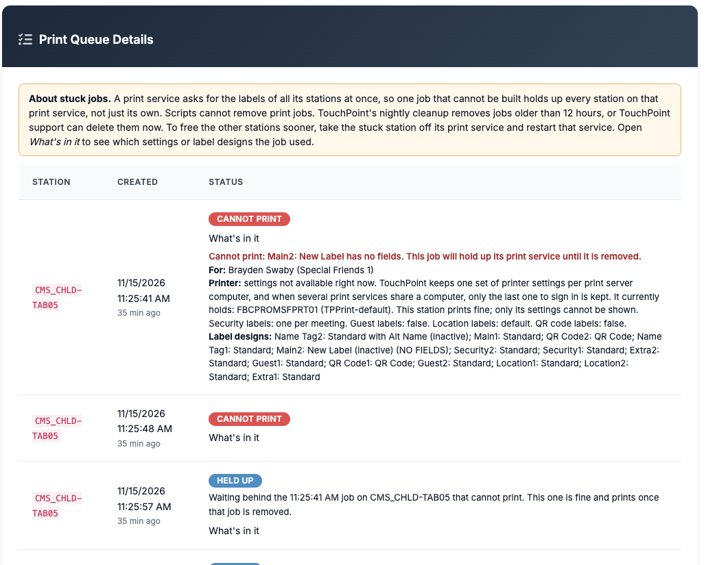
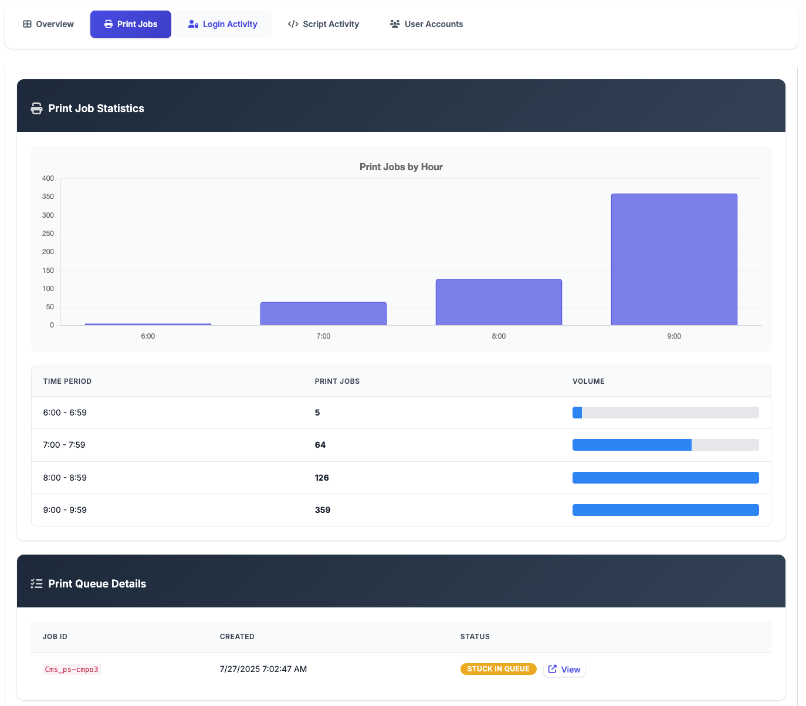
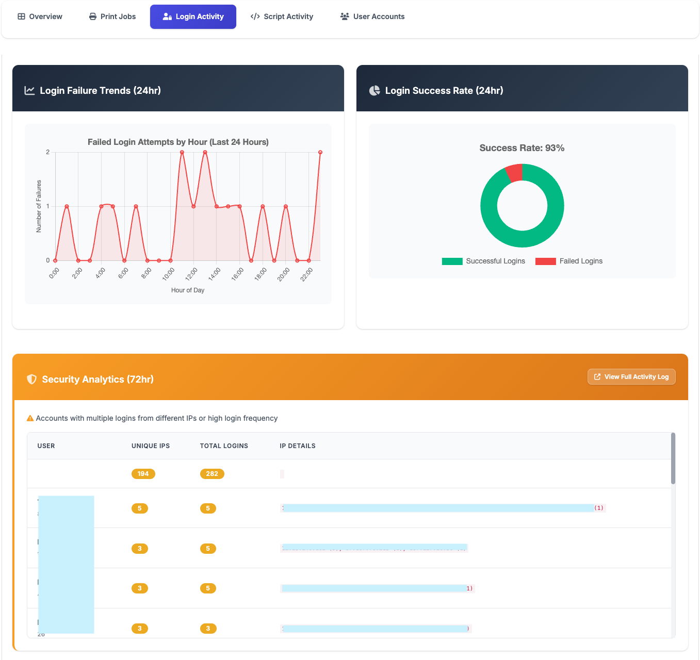
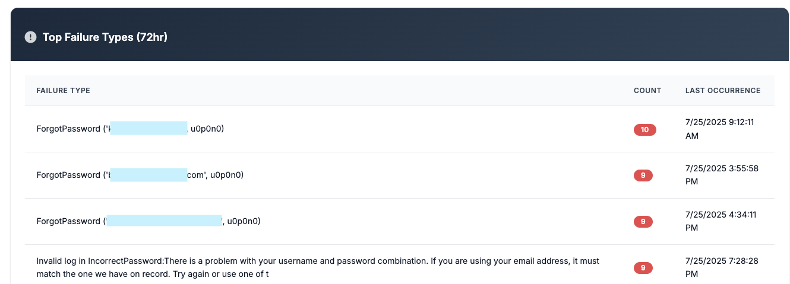
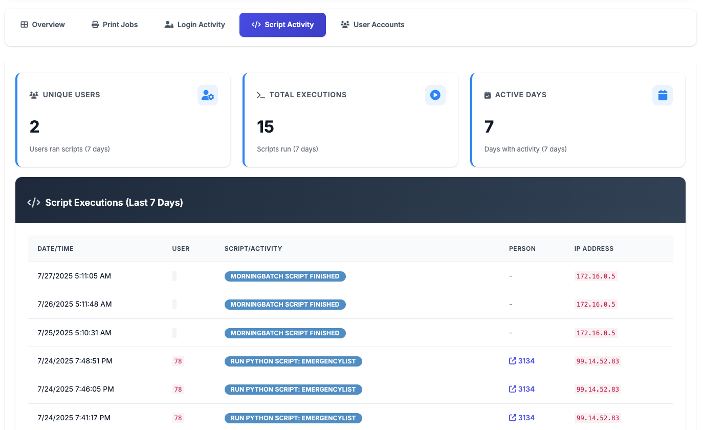
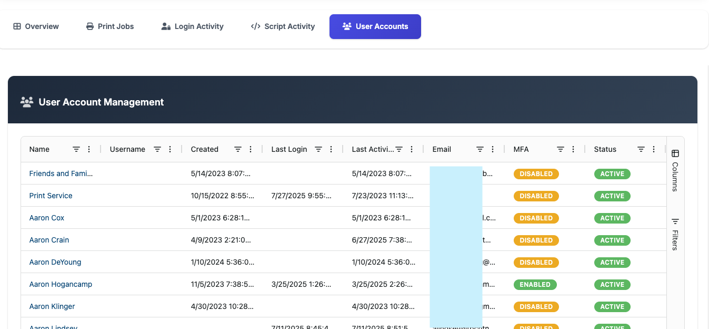

### 🖥️ [TPxi Technical Status](https://github.com/bswaby/Touchpoint/tree/main/TPxi/Tech%20Status)
**When someone says "printing is broken," see why in one page.**

Check-in printing, failed sign-ins, script activity and user accounts on one dashboard. The print queue shows every label still waiting, what is in it, and which job is holding the rest up.

- ⚙️ **Implementation Level:** Easy
- 🧩 **Installation:** Single script, no setup. Paste [TPxi_TechStatus.py](https://github.com/bswaby/Touchpoint/blob/main/TPxi/Tech%20Status/TPxi_TechStatus.py) into Special Content > Python as `TPxi_TechnicalStatus` and open `/PyScript/TPxi_TechnicalStatus`.

  

## What you can see

<strong>Print Queue Details</strong>

Every label still waiting to print, with a plain status:

<ul>
  <li><b>Cannot print</b>: the job can never print, for example because it uses a label design with no fields. It names the design.</li>
  <li><b>Held up</b>: the job is fine but waiting behind one that cannot print.</li>
  <li><b>Stuck in Queue</b>: waiting 2 minutes or more with no known cause, such as a print service that is off or a station name that does not match.</li>
  <li><b>Waiting to print</b>: just sent.</li>
</ul>

Open <i>What's in it</i> on any job to see the label designs and settings it used, and the printer settings when TouchPoint has them. Admins also see who the labels are for.

  

<strong>Print Jobs</strong>

Labels printed by hour today. <i>TouchPoint clears its print records nightly, so this covers today only.</i>

  

<strong>Login Activity</strong>

Failed sign-ins over the last few days: who, how often, and the trend.

  

  

<strong>Script Activity</strong>

Which scripts are running, and who is running them.

  

<strong>User Accounts</strong>

View, filter and sort user accounts.

  

## Good to know

1. **One bad job can stop a whole print service.** A print service asks for the labels of all its stations at once, so one job that cannot be built holds up every station on it.
2. **Scripts cannot delete print jobs.** TouchPoint's nightly cleanup removes anything older than 12 hours, or TouchPoint support can remove a stuck job right away. To free the other stations sooner, take the stuck station off its print service and restart it.
3. **Printer settings may be missing** when several print services share one computer. TouchPoint keeps only the settings of the last one to sign in. The stations still print.
4. **Jump straight to a tab** by adding it to the address: `#prints`, `#login`, `#scripts` or `#users`.

**Updates:** when a new version is out, Admins see a notice at the top of the page. **Update now** installs it in place. The update check sends your TouchPoint address and the script's version, nothing about any person. To turn that off, set the admin setting `TPxiSendHost` to `0`.
