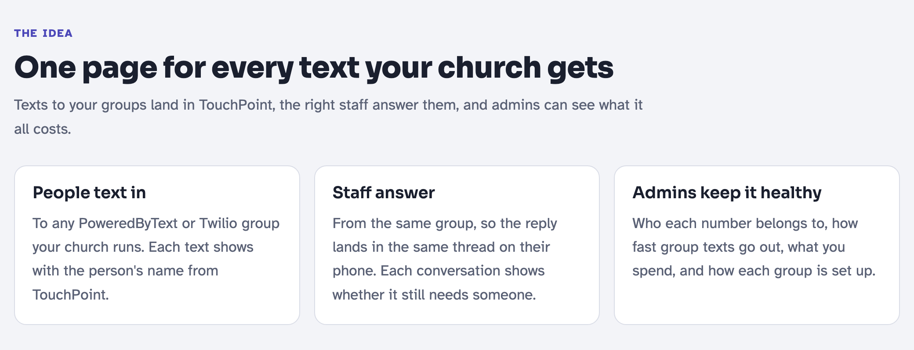
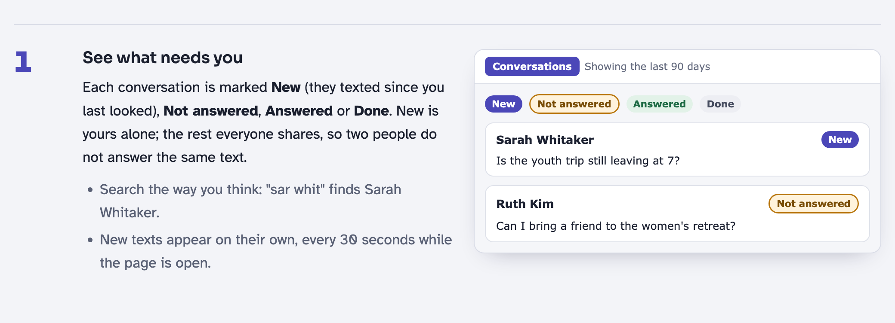
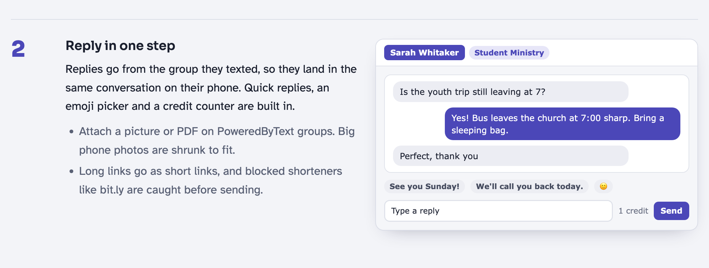
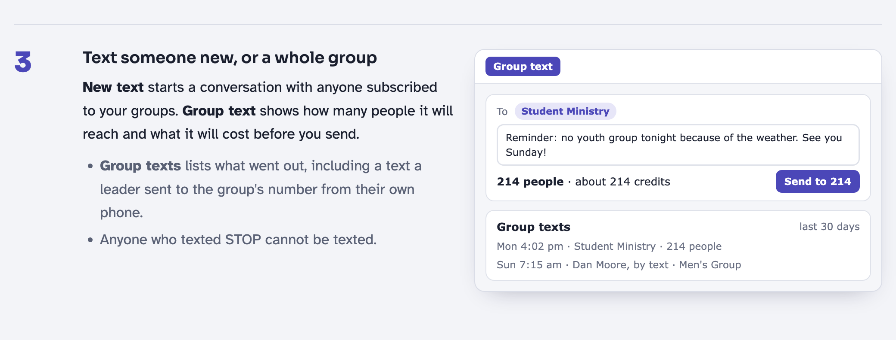
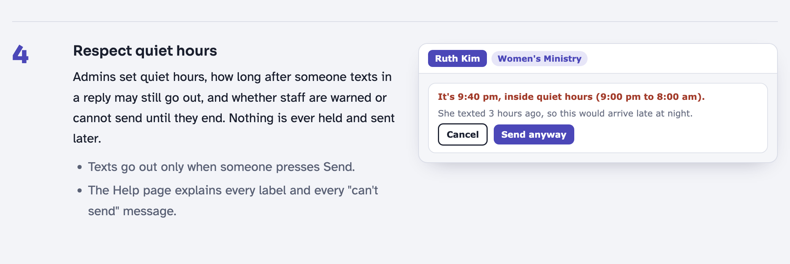
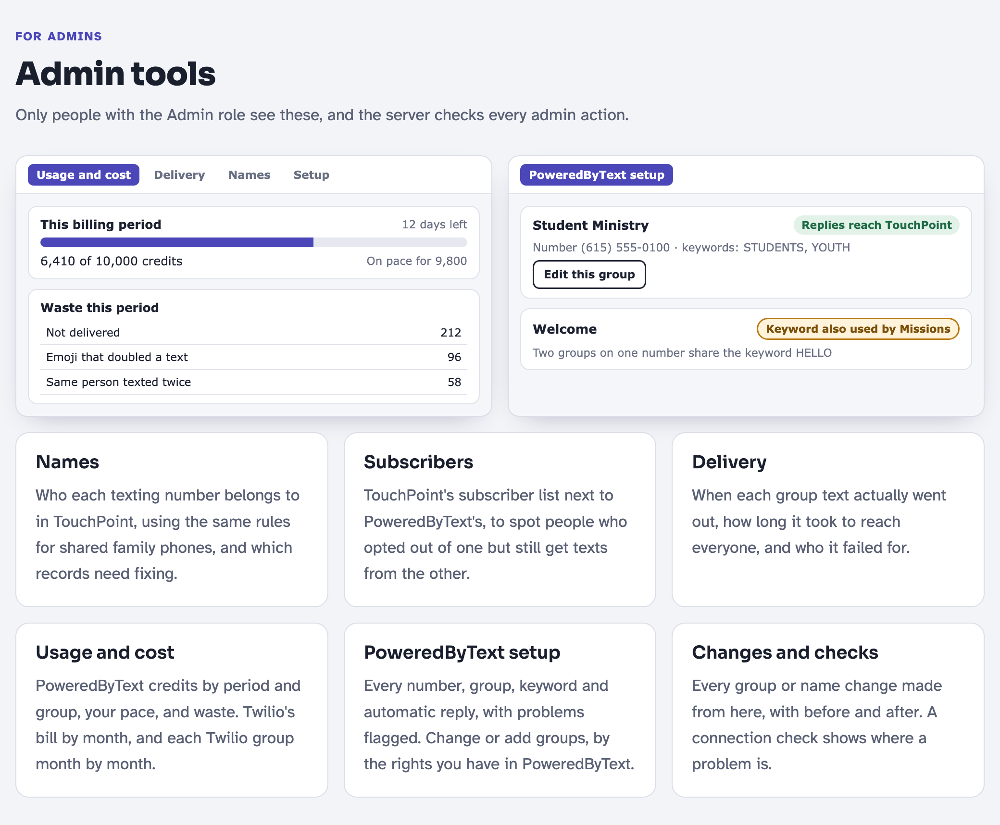
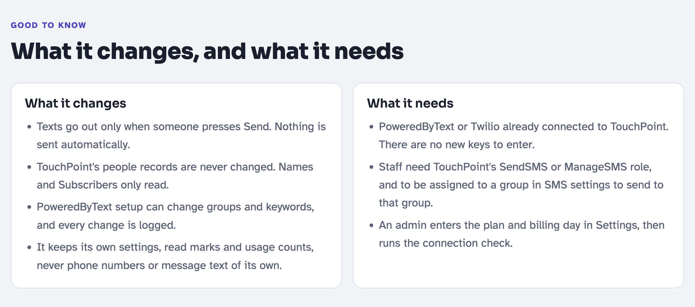

### 💬 [TPxi Texting](https://github.com/bswaby/Touchpoint/tree/main/TPxi/Texting)
**Answer your church's texts without leaving TouchPoint.**

Read and reply to the texts people send your PoweredByText and Twilio groups, right inside TouchPoint. Staff need no PoweredByText login, every text is matched to the person in TouchPoint, and admins see who each number belongs to, how fast group texts go out, and where the credits and dollars go.

- ⚙️ **Implementation Level:** Easy
- 🧩 **Installation:** Single script. Paste it into Special Content > Python as `TPxi_Texting` and open `/PyScriptForm/TPxi_Texting`.

  

  

## For staff: a day in the inbox
You see the conversations for the groups you are listed in on TouchPoint's SMS settings. The pictures use made-up people.

<strong>1. See what needs you</strong>

Each conversation is marked New, Not answered, Answered or Done. New is yours alone; the rest everyone shares. Search the way you think: "sar whit" finds Sarah Whitaker.

  

<strong>2. Reply in one step</strong>

Replies go from the group they texted, so they land in the same conversation on their phone. Quick replies, emoji, a credit counter, pictures and PDFs (PoweredByText groups), and safe short links are built in.

  

<strong>3. Text someone new, or a whole group</strong>

New text starts a conversation with anyone subscribed to your groups. Group text shows how many people it reaches and what it costs before you send. Group texts lists what went out, even a text a leader sent to the group's number from their own phone.

  

<strong>4. Respect quiet hours</strong>

Admins set quiet hours and whether staff are warned or cannot send until they end. Nothing is ever held and sent later, and anyone who texted STOP cannot be texted.

  

## For admins: Admin tools
Only people with the Admin role see these.

  

- **Names:** who each texting number belongs to, and which records need fixing, such as a phone number on more than one record (each copy of a group text to it costs a credit).
- **Subscribers:** TouchPoint's subscriber list next to PoweredByText's.
- **Delivery:** when each group text went out, how long it took to reach everyone, and who it failed for.
- **Usage and cost:** PoweredByText credits by period and group, your pace, and waste. Twilio's bill by month, and each Twilio group month by month, with a spreadsheet download.
- **PoweredByText setup:** every number, group, keyword and automatic reply, with problems flagged. Change or add groups without signing in to PoweredByText, by the rights you have there.
- **Changes:** every group and name change made from here, with who, when, and before and after.
- **Connection check** and **Settings** (plan and billing day, quiet hours, emoji and attachments).

## What it changes, and before you start

  

1. PoweredByText or Twilio must already be connected to TouchPoint. There are no new keys to enter.
2. Staff need TouchPoint's **SendSMS** or **ManageSMS** role, and to be assigned to a group in TouchPoint's SMS settings to send to that group.
3. After installing, an admin opens **Admin tools > Settings** to enter the plan and billing day, then runs **Connection check**.
4. The first time **Usage and cost** opens, press **Count now**. It reads the last two months from PoweredByText (about a minute) and saves them. After that it reads only what is new.

**Updates:** when a new version is out, admins see a notice at the top of the page. **Update now** installs it in place, and settings, conversations and saved counts are kept.

**On your phone:** the page works in a phone browser. [TPxi Go](https://tpxigo.com), an app for TouchPoint, brings the same texting to your phone, with an alert when someone texts in.
